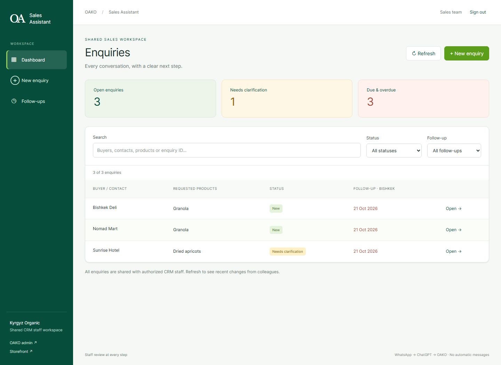

# OAKO Sales Assistant — Phase 1

Standalone staff application at **https://oako.kg/sales_assistant/**. Buildless HTML/CSS/native JavaScript modules, using the existing OAKO Firebase configuration and ICF engine. No AI inference, paid AI service, WhatsApp API, scraping, or additional backend is used by this application.

**Released 21 October 2026.** [Open Sales Assistant](https://oako.kg/sales_assistant/) and sign in with an existing authorized OAKO CRM staff account. See [DEPLOYMENT.md](DEPLOYMENT.md) for release and verification details.

## Screen previews

These captures use synthetic local test data. The live application requires authorized staff sign-in.



[WhatsApp intake](preview/02-intake.png) · [Extraction review](preview/03-review.png) · [CRM and product matching](preview/04-matching.png) · [Enquiry details and replies](preview/05-details.png)

## Staff workflow

1. Sign in with an existing OAKO invoice/CRM staff account.
2. Open **New enquiry** and paste the original WhatsApp message (include relevant conversation context).
3. Copy the extraction prompt, paste it into ChatGPT manually, and copy its JSON response back into the application.
4. Validate JSON. Malformed JSON, unknown keys, invalid types, invalid dates and invalid contact formats block review. Unknown/missing details remain blank; quantities remain null. No country code is guessed.
5. Review and edit the suggested details. Check each field you have verified. Editing a field clears its confirmation; editing buyer information also clears customer linking/creation confirmation. Explicitly mark ambiguity entries resolved only after clarification.
6. Confirm the exact existing CRM customer and each catalog product. Unknown customers/products may remain unlinked. Incomplete enquiries can be saved.
7. To create a customer, first confirm every populated buyer field, choose the existing CRM category, supply its six-digit PIN starting with `1`, and explicitly check the creation confirmation. A detected duplicate blocks creation. No customer login or business-price approval is created.
8. Save. Open the enquiry, update status/follow-up date/note, and save those changes. Review/edit the English follow-up draft and confirm the customer reply language. For a non-English reply, **Copy ChatGPT translation prompt**, paste it into ChatGPT, then paste its translated reply into **Customer-language reply**. Review the reply, check its review confirmation, and **Copy for WhatsApp**. Send manually. Copying does not complete a follow-up.

### Multilingual intake and replies

The extraction prompt supports English, Russian, Urdu and other languages, including mixed-language messages. It asks ChatGPT for English structured records and a faithful full English translation in `messageEnglish`, alongside `sourceLanguage` and `replyLanguage` (English language names, with script preferences such as `Urdu (Latin script)`). An explicitly requested reply language takes precedence; otherwise the clear main language is suggested. Mixed/uncertain languages remain unknown and require staff clarification. Personal/company names are not semantically translated: official Latin spellings are retained or names are transliterated for staff review. Phones, emails, identifiers and quantities remain faithful to the original.

The original source message and original JSON remain immutable in their original language. English translation, source language and reply language are separately reviewable/confirmable; staff notes and corrected record descriptions should also be entered in English. This is a manual AI workflow: schema validation cannot prove the semantic quality or language of a translation, so staff must verify it.

Outgoing drafts are generated in English for staff review. The translation prompt carries the selected reply language/script, the original message as untrusted context, and the authoritative English draft. Unknown languages never silently default to English. For English replies the English draft populates the customer reply; other languages require staff to paste a translated response. Changing the English draft or reply language clears the previous translated text/review. Copying is blocked until a language and nonempty reply are supplied and staff explicitly confirm review. Reply text remains a transient working draft; the selected reply language is saved with the enquiry. Textareas and original messages support automatic text direction for Urdu/Arabic.

Older enquiries without language fields remain readable and editable. Their original extraction is not reinterpreted or rewritten when language metadata is added. No translation API or automatic sending is introduced.

Drafts exist in memory only. Navigation/sign-out/refresh warns about unsaved changes; a failed save retains the current form while the session remains authorized. Revocation/sign-out clears private UI and application memory. Browser crash or forced closure can lose unsaved drafts. This phase does not offer offline saves or persistent private caches. Follow-up dates are calendar dates in **Asia/Bishkek**; overdue includes open enquiries due before today. The Follow-ups view initially shows due and overdue items; use filters for today, unscheduled, or all dates.

## Architecture and reuse

- `index.html`, `styles.css`, `app.js`, `view.mjs`: isolated shell, navigation, five screens, accessibility, clipboard fallback, validation feedback and session handling.
- `domain.mjs`: strict extraction boundary, review schema, explicit confirmation requirements, CRM/catalog matching, missing-information checks, prompt and follow-up generation. A future extractor can produce the same structured object without changing matching/saving.
- `repository.js`: existing `firebase-config.js` singletons, Firebase 10.7.1 modules and `tenant-auth.js` login. Profile subscription detects staff-role changes; authoritative server reads verify identity before private reads and saves.
- `repository-core.mjs`: thin, injectable Firestore adapter with no UI. Existing direct SDK collection/document patterns are retained. Server failures are surfaced rather than interpreted as empty customer lists.
- `icf/`: application-specific registered `SaveSalesEnquiryIntent`, six named stages, separate stage files under their `domain` categories. It reuses `../ICF/engine/intentRegistry.js` and `pipeline.js`. Enquiry creation, confirmed CRM creation/linking, detail edits, and status/follow-up changes all pass through this intent. Related database writes occur together in a Firestore transaction; activity is written inside the same transaction. No private message content or PIN is logged by the app.

### Authentication and permissions

The authoritative invoice application's `js/core/authService.js` and existing customer rules authorize profile roles `admin`, `owner`, `manager`, `superadmin`, `super_admin`. Sales Assistant uses exactly those roles in `/users/{uid}`. Token role claims, absent profiles, or browser-supplied actor roles cannot grant access. Website-only roles `orders`, `products`, `marketing` do not acquire CRM access.

Per the approved shared-staff policy, all existing CRM-authorized staff can see and update these enquiries, just as they can access the CRM. There is no owner-only restriction or new role. The app records `companyId: kyrgyz-organics` and uses the existing OAKO catalog, including legacy catalog documents without `companyId`. It does not infer a tenant from query parameters or a previously selected admin store. CRM records are global, as in the invoice application's customer service; archived customers are excluded from new matches. The app does not broaden any existing customer/product rules.

Static login/UI files are public; customer records, messages, extractions, and activity require authenticated staff access enforced by Firestore rules. The new collection is denied by existing default-deny rules until the additive rules are published. Local rules have not been deployed. Firebase web configuration contains the existing public web app identifiers; no service-account credentials or private keys are added.

### CRM and catalog compatibility

The sibling invoice program is the schema source: `Automated Invoice Program/js/services/customerService.js` and `js/views/customerView.js`. Existing invoice code lives outside this website checkout and cannot be imported from a separately hosted site. The app therefore reads/writes the same **customers** records with a small compatible adapter instead of duplicating the CRM or importing its UI/offline dependencies.

Created customer fields: `companyName`, contact `name` (falls back to company name if blank, as the invoice form does), `phone`, `email`, `address`, `notes: ''`, `category`, `pinCode`, `createdAt`, `updatedAt`. Existing customers are never overwritten. Phone/email/name matches are suggestions, never automatic links. Product records use existing multilingual names, weight and `active`/`companyId`; no price, order, invoice, inventory or catalog mutation is performed.

### Enquiry schema

Collection: `sales_enquiries/{id}`. `id` is SHA-256 of `kyrgyz-organics + newline + originalMessage.trim()`; identical source messages resolve to one enquiry. If two genuine enquiries have exactly the same message, open the existing enquiry or include the distinguishing original conversation context rather than duplicating it. This content-based duplicate check is not semantic deduplication.

| Field | Purpose |
| --- | --- |
| `schemaVersion: 1`, `companyId`, `source: whatsapp-manual` | App schema and source |
| `originalMessage`, `rawJson`, `extracted` | Immutable source message, exact JSON text, typed extracted suggestions |
| `review.buyer` | `companyName`, `name`, `phone`, `email`, `address` |
| `review.products[]` | `requestedName`, nullable `quantity`, `unit`, `ambiguities`, `detailsConfirmed` for reviewed request values, and optional confirmed `productId`/`productConfirmed` for the catalog reference |
| `review.confirmed` | Per-field booleans distinguishing confirmed values from suggestions |
| `review.ambiguities`, `resolvedAmbiguities` | Original uncertainties and staff resolution markers |
| `review.deliveryCity`, `firstDeliveryDate`, `frequency`, `notes` | Reviewed requirements |
| `review.sourceLanguage`, `replyLanguage`, `messageEnglish` | Optional, backward-compatible language metadata and English translation, separately confirmed from the original source |
| `review.customerId`, `customerConfirmed` | Explicit CRM reference; empty when unlinked |
| `review.status` | New, Needs clarification, Qualified, Closed won, Closed lost |
| `review.followUpDate`, `followUpNote` | Manually tracked next action |
| `revision`, `createdAt`, `createdBy`, `updatedAt`, `updatedBy` | Concurrency and audit metadata |

`review.category` retains the CRM category selection. Creation flags are reset to false and `pinCode` is reset to an empty string in the saved enquiry; the PIN is stored only on its CRM record. No customer pricing status is inferred from enquiry status. Staff may move between all listed statuses, including reopening closed enquiries; statuses do not create orders or send messages.

`sales_enquiries/{id}/activity/{revision}` records actor UID, server timestamp, revision, action, status, customer reference/creation flag and follow-up date. Source text and PINs are excluded. Rules require an activity event for each enquiry revision and disallow activity edits/deletes. The timeline records each save, rather than recording every field's before/after value.

### Duplicates, concurrency, and limits

- New customer creation checks the latest server CRM for an exact normalized business name, email, or digit-normalized phone. Staff must resolve an existing match instead of creating another record.
- New customer document IDs are `sa_` plus SHA-256 of phone identity (or email when no phone). Concurrent Sales Assistant creations with that same identity cannot create two customer documents.
- Uniqueness cannot be guaranteed across unmodified external CRM writers, or simultaneous records using different primary identities; duplicate checks and deterministic IDs are safeguards, not a global CRM uniqueness migration. Local phone formats are not guessed to equal international formats. Archived records are not suggested; a matching deterministic ID belonging to an archived customer requires CRM review/restoration rather than silent replacement.
- Save retries do not create additional enquiries. Revisions prevent overwriting changes made by another staff member. On conflict, copy any needed unsaved corrections, refresh, then review and save again.
- A timeout/interrupted connection is not proof that a write failed. Keep the tab open, restore connectivity, and refresh the dashboard before trying to create another enquiry. No success is shown without a transaction acknowledgement.
- Input limits: message 20,000 characters, JSON 50,000, 30 requested products, ordinary fields 500, notes 2,000. Dashboard reads the application's enquiry collection and filters/searches in memory, matching the existing small-data patterns. Large-volume server pagination/search is outside Phase 1.

## Local verification

Node 22, Java 21, Firebase CLI, and a Playwright Chromium installation are required for the full suite. Unit tests require only Node. Test dependencies are isolated from runtime and specified in `tests/sales-assistant/package.json`.

From the `KyrgyzOrganics` repository root:

```powershell
node --test tests/sales-assistant/domain.test.mjs
npm --prefix tests/sales-assistant install
npm --prefix tests/sales-assistant exec -- playwright install chromium
node tests/sales-assistant/run-emulators.cjs
```

The runner starts Firestore `8088`, Authentication `9098`, Hosting `5088` using **demo-sales-assistant**, writes only ignored `output/sales-assistant/` artifacts, and shuts down owned emulators after testing. It runs `rules.integration.mjs` then `browser.cjs`. These tests clear **only the demo project** and create synthetic accounts/data; no production credentials or data are needed. The Windows runner uses the existing invoice test harness's Java TCP-selector workaround.

Browser tests use the actual application, repository, Firebase SDK and local services. Only `firebase-config.js` is replaced in the test browser to point at the emulators; Firebase SDK modules are bundled from the test dependencies for reproducible offline browser execution. There is no production demo account, fixture switch, or auth bypass. Synthetic screenshots `01-dashboard.png` through `05-details.png` are written to ignored output. Existing website routes are checked through Firebase Hosting for successful HTML responses; their full independent business workflows are outside this application's regression suite.

If reusing already-installed dependencies, `SALES_TEST_MODULES` may point to an absolute `node_modules` directory containing Firebase/rules-unit-testing/esbuild, and `SALES_PLAYWRIGHT_MODULES` to an installed Playwright `node_modules` directory. These environment variables are test-runner conveniences only; production never reads them.

### Manual acceptance checklist

1. Open `/sales_assistant/` directly; refresh before login and after opening an enquiry hash URL. Confirm that assets load and signed-out users see no enquiry data.
2. Verify existing `/`, `/admin/admin.html`, `/dailybread/`, `/product.html`, `/hamster_game/`, `/p/`, `/q/` still serve their existing pages.
3. Sign in as an existing CRM staff member. Verify the dashboard search/status/date filters, empty states, and follow-up list.
4. Use the full manual WhatsApp → ChatGPT → JSON workflow above. Try malformed JSON, Markdown fences, nulls/missing fields, a nonnumeric quantity, ambiguous product names and dates. Verify clear errors and editable suggestions.
5. Match an existing CRM customer and multilingual catalog product. Verify there is no link until explicit confirmation. Change buyer/product details and confirm the previous link/field confirmation clears.
6. Save an incomplete enquiry without customer/product links; reload and verify source text, unknown quantities and warnings are retained.
7. Create an explicitly confirmed synthetic CRM contact. Verify it appears in the invoice program without creating a login or approving business prices. Try the same phone/business again and verify duplication is blocked.
8. Save status, follow-up date and note; reload and verify the timeline. Review/edit/copy follow-up questions and paste manually into WhatsApp without sending during verification.
9. Try duplicate message intake, concurrent edits in two tabs, archived/missing customers and inactive products. Verify clear failures and no partial writes.
10. Deny reads/writes in an isolated test environment, or disconnect the network. Verify no false success, no failed-read-as-empty CRM, preserved authorized drafts and retry guidance.
11. Test signed-out/customer accounts and role revocation; verify private content is absent/cleared. Verify the clipboard fallback when clipboard permission is denied. Check keyboard navigation and a narrow viewport.

## Deployment — requires explicit approval

The review branch contains the application, tests, previews and an additive rules fragment. Publishing rules and deploying the website require separate explicit approval. Existing unrelated local changes must remain intact.

1. Review the isolated application, test output, and scoped changes. Verify the actual current hosting settings and authoritative live Firestore rules; local documentation states that `oako.kg` uses GitHub Pages (`main`, root) and a separate Firebase Hosting copy.
2. Merge `security/firestore.fragment.txt` inside the document scope of the latest authoritative production rules, alongside the existing CRM rules and `isAdmin` helper. Preserve all unrelated website/invoice rules. Full local rules are deliberately excluded from the review commit, following this repository's manual Firebase Console management convention. Do not blindly replace production rules with an old local copy. The app requires no Functions or Storage rules change and no new composite indexes.
3. Run all Sales Assistant unit/emulator/browser tests and relevant existing checks. Review the manual acceptance checklist with authorized staff.
4. After explicit release approval, publish the reviewed additive rules first through the project's established rules-management process. Confirm anonymous/customer denial and authorized staff access. An omitted rule block causes a deliberate permission-denied state, not a fallback to public access.
5. After explicit Git approval, commit/push only reviewed files through the existing GitHub Pages release process. After explicit hosting approval, run the existing Firebase Hosting release from the **repository root**, not the nested `functions/` folder. The hosting-only command is `firebase deploy --only hosting --project oa-kyrgyz-organic`; this is documentation, not an action already taken.
6. Verify `https://oako.kg/sales_assistant/` and its Firebase Hosting equivalent, both directly and on refresh/hash navigation. Check existing routes. Use a separately approved synthetic record for any production write verification; do not use real messages as test fixtures.

Routing needs no new broad rewrite: GitHub Pages and Firebase Hosting serve the concrete `sales_assistant/index.html` directory. Hash routes (`#dashboard`, `#new`, `#follow-ups`, `#enquiry/{id}`) preserve direct refresh without intercepting other OAKO paths. Assets/imports use paths that work under `/sales_assistant/`. The only shared routing change is reserving `sales_assistant` in `company-config.js`, preventing it from being mistaken for a storefront tenant. Existing hosting rewrites are unchanged.

Rollback: restore/remove only the Sales Assistant frontend release while keeping unrelated routes intact. Retain protected enquiry records for staff review; do not open their rules or delete CRM customers as a rollback action. If rules are rolled back, remove only the additive Sales Assistant block, leaving the default deny and existing CRM rules unchanged.

## Modified files

- Added `sales_assistant/`: the standalone application, domain/repository modules, isolated ICF stages and this documentation.
- Added `tests/sales-assistant/`: dependency manifest, unit tests, repository/rules tests, browser/hosting workflow tests and emulator runner.
- Added `sales_assistant/security/firestore.fragment.txt`: additive enquiry rules for review/manual publication; emulator tests compose this fragment with existing base rules when needed.
- Added `sales_assistant/preview/`: five synthetic screen captures for GitHub review.
- Updated `company-config.js`: one reserved route segment.
- Updated local `firestore.rules` during implementation/testing: additive Sales Assistant validation/access/activity block only. The full file stays out of the review commit; other pre-existing local rule changes are preserved.
- No changes to existing admin, invoice program, Functions, Storage configuration, hosting rewrites, customer/product records, or production data were made by this task.
